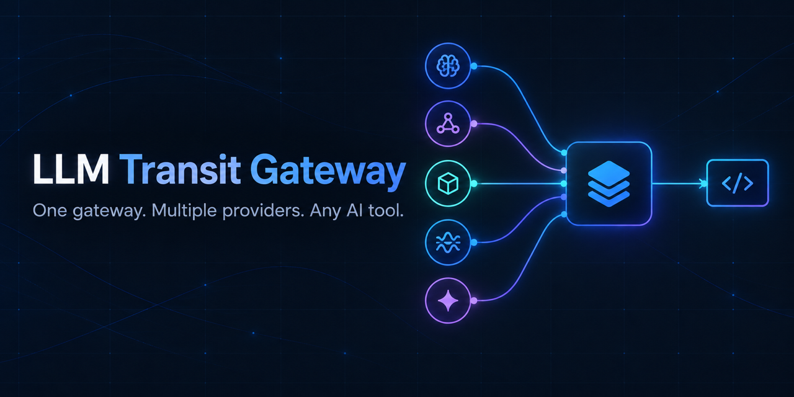

# LLM Transit Gateway

[English](README_EN.md) | **简体中文**



[](https://github.com/ml451953014/llm-transit-gateway/actions/workflows/ci.yml)
[](LICENSE)


让 Gemini、Vertex AI、Claude、OpenAI 等模型通过统一接口接入常用 AI 工具。

LLM Transit Gateway 是一个本地优先的多厂商兼容网关。它向客户端统一提供 OpenAI 兼容的 `/v1/chat/completions` 与 `/v1/responses` 接口，后端可同时连接 Gemini API、Google Vertex AI、AWS Bedrock、OpenAI、Anthropic 和自定义 OpenAI 兼容线路。

## 核心亮点

- **让 Gemini 用在更多 AI 工具中**：把 Gemini API 和 Vertex AI 模型统一转换为常见客户端能够识别的接口，可供 cc-switch、Cursor、VS Code 插件、OpenAI SDK 等工具使用。
- **不是简单转发，而是兼容层**：修复不同客户端、LiteLLM 和上游厂商之间的请求差异，包括 Gemini 思维参数、tool call、结构化输出、消息尾部角色和无效字段。
- **Gemini 思维签名与长会话兼容**：识别并清理跨模型历史中无意义的 `__thought__` 签名后缀，递归解包 LiteLLM 的 `encitem_` ID，并保持 tool call 引用关系一致，避免 Responses API 长会话因 ID 超长或字符非法而中断。
- **多 Vertex 项目独立管理**：每个 Google Cloud 项目对应一个独立网关实例，可选择无长期私钥的 gcloud ADC 或服务账号 JSON，各自拥有模型权限、调用前缀和并发限制；同名模型可以显式指定默认路由，不会误入错误项目。
- **针对 Agent 长会话优化**：自动修复损坏的工具参数、重建 Bedrock `toolConfig`、规范化 tool call ID，并处理流式首包超时、真实状态码透传和中途断流。
- **可视化配置和排障**：通过 Web 控制台添加、删除和配置厂商，选择 Vertex ADC 或一键导入服务账号 JSON、拉取模型、测试全部对外接口并查看实时日志。

## 架构

```
客户端 (Claude Code / cc-switch / OpenAI SDK / VSCode / Cursor 等)
        │  Base URL: http://localhost:4000/v1
        ▼
┌─────────────────────────────┐
│  proxy.py (FastAPI, :4000)  │  · Web 管理控制台
│  - 请求体清理/修复          │  · 管理 API（增删厂商、拉取模型、重启）
│  - 按厂商分组的并发限流     │  · 实时日志推送（SSE）
│  - 转发到 LiteLLM           │
└──────────────┬──────────────┘
               ▼
┌─────────────────────────────┐
│  LiteLLM Proxy (:4001)      │  · 统一路由到各厂商 SDK
│  - 重试 / mid-stream 兜底   │
└──────────────┬──────────────┘
               ▼
     Gemini / Vertex AI / Bedrock / OpenAI / Anthropic / 自定义 OpenAI 兼容线路
```

两层网关的分工：`proxy.py` 负责客户端请求进来之后的清理和管理面（Web UI、配置持久化、并发控制），`LiteLLM` 负责真正对接各厂商 SDK、做重试和 fallback。

## 功能详情

- **多厂商聚合**：Gemini、Vertex AI（ADC 或 Service Account）、AWS Bedrock（Bearer Token）、OpenAI、Anthropic Direct，以及任意数量的自定义 OpenAI 兼容线路（中转站、SiliconFlow 等）。
- **Web 管理控制台**（`http://localhost:4000/`）：
  - 按厂商配置 API Key / Base URL / 专属凭证字段
  - 可创建多个 Vertex AI 项目实例：每个项目可独立选择 ADC 或服务账号、模型集合和调用前缀
  - 一键拉取厂商模型列表，勾选启用哪些模型
  - 全局设置：默认并发上限、按厂商单独覆盖并发上限、重试次数/间隔、请求超时
  - 内置连通性测试面板
  - 实时日志流（SSE），只展示 WARNING/ERROR 及关键事件
- **请求体自动修复**（`proxy.py` 里的 `_clean_body`）：
  - 规范化 Gemini 的 `reasoning_effort` / `thinking_level` 别名（如 `xhigh` → `high`）
  - 处理 Gemini 思维签名与 LiteLLM 嵌套编码 ID，保证跨模型历史满足 Responses API 的长度和字符集约束
  - 修复历史消息中损坏的 tool call JSON 参数
  - 清理空/非法的 `tools` 字段
  - Gemini 要求对话以 user 消息结尾，自动裁剪末尾的 assistant 消息
  - Bedrock 专项修复：tool call ID 规范化（≤64 字符）、缺失 toolConfig 自动重建、超限图片自动缩放（多图请求单图长边 ≤2000px）、剔除 Bedrock 不支持的参数
- **Gemini 思维签名与跨账号上下文压缩**：LiteLLM 会把 Gemini 的思维签名拼进工具调用 id（`call_x__thought__<base64>`），实测 137 字符，长会话可达 2800+，超过 OpenAI 要求的 64 字符。客户端（如 Codex）把它存进会话历史，之后切到官方 OpenAI 账号做上下文压缩时，请求直接发给 OpenAI、不经过本网关，会报 `call_id: string too long`。网关因此在**返回方向**处理：
  - `/v1/responses` 的 Gemini 响应里，含 `__thought__` 的 id 换成「原前缀 + 完整 id 哈希」的短 id，满足 ≤64 字符且只含字母、数字、下划线、连字符。function_call 项自己的 `id`（及流式事件的 `item_id`）统一改成 `fc_` 开头：官方 OpenAI 会校验这个前缀，而 Gemini 返回的 `id` 与 `call_id` 原本是同一个 `call_…` 值，不改的话切回官方账号会报 `Expected an ID that begins with 'fc'`；`call_id` 保持 `call_` 开头；没有签名的 Gemini 工具调用同样把 `id` 换成 `fc_`。非流式 JSON 与流式 SSE 的全部位置（`output_item.added/done`、`function_call_arguments.delta/done`、`response.completed` 等）改写成同一个值，网络分片切在任意位置都不影响。
  - 完整 id 记在网关内存缓存里（最多 4000 条，LRU）。下一轮客户端带着短 id 回来、目标仍是产出它的那个 Gemini 模型时，换回带签名的完整 id，Gemini 继续拿到上一轮的推理上下文；换了模型或网关重启导致缓存丢失，则退回到不带签名。
  - 只影响 `/v1/responses` 且目标为 Gemini 的响应；`/v1/messages`（Claude Code）、`/v1/chat/completions` 与其他厂商的响应保持原样。
- **流式请求的错误透传**：上游返回 4xx/5xx 时，网关把真实状态码和错误信息交给客户端，而不是回 `200` 再把错误 JSON 当流内容发出去（客户端会以为成功、却收不到任何合法事件而断开）。等待上游响应头最多 3 秒；超过则先开流，之后的 4xx 以 `response.failed` 事件告知，429/5xx 直接结束流让客户端重试。客户端在流开始前断开时，网关会关闭上游连接并归还并发名额。
- **上游拒收时保留现场**：上游返回 4xx（429 除外）时，把网关实际转发的请求体存到 `logs/failed_requests/`（保留最近 20 份，目录已被 `.gitignore` 排除，内容含对话历史，不要手动提交）；日志里把长调用栈折叠成一行「上游拒绝」摘要。
- **Gemini 结构化输出 + 大量工具**：Vertex Gemini 对「`text.format=json_schema`」与大量函数声明（实测 89 个通过、131 个报 `400 INVALID_ARGUMENT`）同时出现的请求直接拒收。函数数超过 80 且要求 JSON 输出时，网关去掉 `tools` 再转发（这类请求只要结构化输出、不调用工具）。
- **按厂商分组的并发限流**：不同厂商的并发配额互不挤占（例如 Vertex 项目在高并发下容易 429，可以单独限制，不会拖累其他厂商）。在 Web 页面调整后无需重启整个网关进程即可生效。
- **自动重试与 mid-stream 兜底**：所有厂商模型都配置了 LiteLLM 的 fallback（重试同一个模型），网络抖动导致的连接中断能自动恢复。
- **实时日志广播 + 落盘**：控制台过滤纯噪音行，日志文件只记录 WARNING/ERROR/CRITICAL 及其 traceback，按天分文件，支持保留天数自动清理。

## 快速开始

### 依赖

- Python 3.11（`start.sh` 会自动探测 conda 环境）
- 见 [`requirements.txt`](requirements.txt)：`litellm[proxy]`、`python-dotenv`、`Pillow`、`google-auth`

### 安装

```bash
./install.sh
# 等价于：conda run -n py311 pip install -r requirements.txt
```

### 启动

```bash
./start.sh
```

`start.sh` 会自动探测同时满足「Python 3.11」和「同级目录装有 litellm」的 conda 环境；也可以用 `PYTHON_BIN=/path/to/python ./start.sh` 手动指定。首次启动会在当前目录生成 `providers_config.json`（默认全部厂商禁用），需要去 Web 控制台或直接编辑该文件填入凭证。

启动后：

- Web 控制台：`http://localhost:4000/`
- API Base URL：`http://localhost:4000/v1`

### 配置厂商

打开 `http://localhost:4000/`，在左侧选择厂商 → 填入 API Key（或 Vertex/Bedrock 的专属凭证字段）→ 点击「拉取模型」→ 勾选需要启用的模型 → 打开厂商启用开关 → 「保存并应用」。保存后会自动重新生成 `litellm_config.yaml` 并重启 LiteLLM 子进程。

需要接入多个 Vertex 项目时，点击「添加网关」→「Google Vertex AI」，为每个项目创建实例并选择鉴权方式。每个实例必须使用唯一调用前缀，例如 `vertex_google/`、`vertex_claude/`。拉取结果来自各 publisher 的 Model Garden 候选列表，并不等于账号一定有调用权限；请保存后用「API 接口」逐个确认。

#### Vertex AI 使用 gcloud ADC（推荐）

ADC 使用短期访问令牌，网关不会复制或保存服务账号私钥。Web 控制台会先检测运行网关的系统账号是否已有 ADC：已有凭证会直接复用，不再显示登录命令；尚未配置或凭证失效时，点击 **登录 Google 账号**，网关会在本机启动 gcloud 并打开 Google 授权页面。该授权只需完成一次，多个 Vertex 项目可以复用。

如果未安装 gcloud、浏览器无法自动打开，或网关运行在 Docker/远程服务器中，请用**运行网关的同一个系统账号**执行页面提供的兜底命令：

```bash
gcloud auth application-default login
```

然后在 Vertex 实例中选择 `Application Default Credentials`，填写明确的 Google Cloud 项目 ID 和 Location，再拉取模型。`gcloud auth login` 与 ADC 是两套独立凭证，不能替代上述命令。遇到 quota project 提示时执行：

```bash
gcloud auth application-default set-quota-project YOUR_PROJECT_ID
```

同一份 ADC 身份可以配置多个 Vertex 项目实例，前提是该身份在每个项目中都拥有所需的 Vertex AI IAM 权限。切换已有实例到 ADC 并保存后，网关会从本项目配置及生成的 `vertex_sa_*.json` 中移除该实例的旧服务账号私钥。

也可以直接编辑 `providers_config.json`（参考 [`env_demo`](env_demo) 了解可迁移的环境变量），字段结构：

```jsonc
{
  "server": {
    "proxy_host": "127.0.0.1",            // 默认仅本机可访问；确需局域网访问时再显式修改
    "proxy_port": 4000,
    "litellm_port": 4001,
    "log_retention_days": 7,
    "request_timeout": 600,
    "num_retries": 3,
    "retry_after": 1,
    "allowed_fails": 3,
    "default_concurrency": 16,          // 未单独配置的厂商统一用这个并发上限
    "provider_concurrency": { "vertex_google": 4 }, // 按厂商实例 id 覆盖
    "bare_model_routes": { "gemini-2.5-pro": "vertex_google" } // 重名模型的裸名默认实例
  },
  "providers": [ /* 每个厂商的 id/type/enabled/api_keys/base_url/models/selected_models/extra */ ]
}
```

### 客户端接入

任意支持 OpenAI 兼容 API 的客户端（Claude Code、cc-switch、Cursor、VSCode 插件、OpenAI SDK 等）：

- Base URL：`http://localhost:4000/v1`
- API Key：任意非空 Bearer 字符串（网关只检查非空，鉴权交由上游厂商凭证）
- Model：优先使用 `厂商id/模型名`（如 `vertex_google/gemini-2.5-pro`）。裸模型名只在全局唯一时自动提供；同一模型存在于多个实例时，必须在控制台显式指定默认实例，否则不会注册该裸名，避免请求误入错误项目。

## 开源生态与兼容客户端

本项目使用 [LiteLLM](https://github.com/BerriAI/litellm) 作为上游厂商路由层，并提供标准的模型列表、Chat Completions 与 Responses 接口。支持自定义 OpenAI Base URL 的开源客户端通常可以直接接入：

| 开源项目 | 接入方式 |
|---|---|
| [CC Switch](https://github.com/farion1231/cc-switch) | 把网关作为自定义供应商，统一配置 Claude Code、Codex、Gemini CLI 等工具 |
| [Open WebUI](https://github.com/open-webui/open-webui) | 添加 OpenAI-compatible 连接，Base URL 使用 `http://localhost:4000/v1` |
| [Cline](https://github.com/cline/cline) | 选择 **OpenAI Compatible**，填写 Base URL、任意非空 API Key 和模型 ID |
| [Continue](https://github.com/continuedev/continue) | 使用 `openai` provider，并把 `apiBase` 指向本项目 |
| [Cherry Studio](https://github.com/CherryHQ/cherry-studio) | 添加自定义 OpenAI 兼容供应商并填写网关地址 |

这里的“兼容”指模型发现与文本/工具调用接口；本项目目前不提供 embeddings、语音或图像生成接口。不同客户端会发送不同扩展字段，遇到差异请提交脱敏后的复现请求。

## 运维

| 脚本 | 作用 |
|---|---|
| `./start.sh` | 探测 Python 环境并启动网关（前台运行，Ctrl+C 退出） |
| `./stop.sh` | 停止配置文件中 proxy_port/litellm_port 对应的进程 |
| `./restart.sh` | 等价于重新执行 `start.sh` |
| `python smoketest.py` | 冒烟测试（需要网关已在运行），验证 Gemini/Bedrock 基础调用、tool call 修复、消息裁剪等已知修复点没有回归 |

日志文件位于 `logs/`，按天分文件（同一天多次启动会追加序号），仅记录 WARNING 及以上级别；控制台输出可通过 Web 控制台的「实时日志」面板查看。

## 已知行为 / 排错

- **LiteLLM 内部 `Task exception was never retrieved` + `AttributeError: 'dict' object has no attribute 'usage'`**：LiteLLM 自身在组装流式响应统计信息时的已知内部问题，不影响请求结果（请求仍返回 200），`proxy.py` 的日志过滤器（`TeeStream`）会自动屏蔽，不会写入日志文件或打印到控制台。
- **`MidStreamFallbackError` / `Vertex_ai_betaException`**：这是上游连接在流式传输中途真实中断（多为 Vertex 网络抖动），不是无害噪音。LiteLLM 的 fallback 机制会自动重试同一个模型，客户端通常感知不到（网关日志会看到一次 500 紧跟一次 200）。如果频率明显升高，考虑调低该厂商的并发上限。
- **并发限制按厂商分组**：如果发现某个厂商的请求排队明显，去 Web 控制台「全局设置」调整该厂商的并发上限或默认并发上限，保存后立即生效，无需重启进程。
- **Codex 切到官方 OpenAI 账号后压缩报 `Invalid 'input[N].call_id': string too long`**：说明会话历史里存着旧版网关返回的带签名长 id。升级到包含「Gemini 思维签名」修复的版本并重启网关后，**新产生**的工具调用才是短 id；已存进旧会话的长 id 无法回溯修复，需要新开会话。压缩到了官方 OpenAI 之后是否还有别的兼容问题（如 id 前缀、第三方加密推理内容），需要以实际报错为准。
- **切回官方 OpenAI 账号后报 `Invalid 'input[N].id': 'call_…'. Expected an ID that begins with 'fc'`**：同一类问题，会话历史里存着旧版网关返回的 `call_…` 形态的 function_call 项 id。新版本返回的是 `fc_…`；已存进旧会话的无法修复，需要新开会话。
- **Gemini 报 `400 Requests ending with a model turn are not supported`**：从官方 OpenAI 账号切回本地 Gemini 继续对话时，Codex 回传的历史末尾可能是官方产出的 `reasoning` 项（只有摘要），被转成「模型回合」后整条请求以模型回合结尾，Vertex 拒收。网关会在目标为 Gemini 时去掉 `input` 末尾连续的 `reasoning` 项（日志会打一行 WARN）；中间的 `reasoning` 项和其他模型不受影响。
- **Gemini 报 `contents[N].parts[0].data: required oneof field 'data'`**：历史里有只含空字符串的助手消息（Codex 在模型只调用工具时留下的）。网关转发给 Gemini 前会去掉空文本片段；如果客户端绕过网关直连中转站，这个清理不生效。
- **Gemini 报 `Invalid value at 'contents[N].parts[0].function_call.args'`**：实测 aicodewith 的 Gemini 会把一次并行的多个工具调用合并成一个，参数变成几个 JSON 首尾相连，客户端执行失败，之后整段历史都会被拒。网关现在会把返回的合并调用拆成独立的调用（流式与非流式），并修复历史里已存在的合并参数（保留第一个命令，这条调用当时并未执行）。
- **日志里出现 `[排队] ... 等待并发名额`**：说明该厂商的并发上限在起作用，请求在网关内排队，而不是上游慢；按需调高该厂商的并发上限。
- **网关重启后第一次 Gemini 工具调用回合**：签名缓存在内存里，重启会清空，此时 LiteLLM 会使用占位签名，Gemini 的推理上下文可能略有损失，之后恢复正常。

## 安全注意事项

- `providers_config.json`、`vertex_sa_*.json`、`.env`、`litellm_config.yaml`、`logs/` 均包含真实凭证或已被 `.gitignore` 排除，**不会**被提交到仓库。首次部署需要自行创建这些文件或通过 Web 控制台填入。
- 网关默认只监听 `127.0.0.1`。推理接口只检查 Bearer Token 非空，不校验身份；管理接口额外限制为同源浏览器或本机脚本调用，但仍不等同于用户认证。如需把 `proxy_host` 改为 `0.0.0.0`，必须在前面增加带认证的反向代理，不要直接暴露到公网。

## 参与贡献与许可证

提交问题或代码前请阅读 [`CONTRIBUTING.md`](CONTRIBUTING.md)。安全问题请按照 [`SECURITY.md`](SECURITY.md) 私密报告，不要创建公开 Issue。

本项目采用 [MIT License](LICENSE)。
